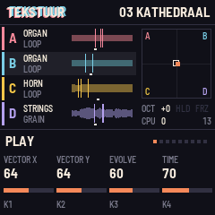

# Tekstuur for the M-VAVE FM-1

A firmware that turns the M-VAVE FM-1 into an instrument for long, slowly moving sound: four layers, each playing a
recorded source as loops, grains, a stretched freeze or ringing strings. Free and open source.

**Install it from the browser: <https://barnir-fm1.pages.dev/tekstuur/>** (Chrome or Edge, a USB cable, about a minute).

Tekstuur is Dutch for texture. The whole instrument is its own firmware: its own sound engine, screens and controls,
on top of [fm1-base](https://github.com/charlesvestal/fm1-base).

Nederlands: [README.nl.md](README.nl.md) and [eigen/README.md](eigen/README.md).

## What it does

Four layers (A, B, C, D). Each plays a source: nine are built in (strings, cello, horn, organ, glass, psaltery, vibes,
reed, noise) and you can send up to eight of your own recordings. A layer plays its source in one of four ways:

- **LOOP**: three play heads per note, each looping a different length, an octave or a fifth apart. Long, calm, always
  shifting.
- **GRAIN**: a cloud of short grains around one place in the source.
- **STRETCH**: the source pulled out until it almost stands still.
- **RESON**: the source strikes three tuned strings that ring with the note.

Each layer has its own filter. A **vector point** mixes the four (a corner is one layer, the middle is all), and
**Evolve** moves that point, the place in the source and the filter by itself. Then chorus, delay and a reverb with
**shimmer** and **freeze**. 56 presets, 16 slots for your own.

## Controls

| | |
| --- | --- |
| keys | play, with velocity; OCT- and OCT+ shift the octave |
| PRESET | choose a preset; SAVE stores the current sound |
| SELECT or SEL | layer A to D |
| K1 to K4 | the four controls of the page; ALGORITHM steps through the pages |
| PLAY | hold notes (a key turns its note on, again: off) |
| SEQ | freeze the reverb |
| HOME, GLO, LFO | PLAY (vector, evolve, time), MIX, MOVE |
| EDIT, ENV, FX | SOURCE / PITCH / TONE, ENVELOPE, EFFECTS / REVERB |
| REC | shows the load |

MIDI over USB and the TRS input: notes, sustain, mod wheel on Evolve, program change.

## Your own sources

    python3 eigen/tools/tekstuur_samples.py stuur eigen/bank/extra.tkb     # five extra sources (flute, piano, harmonica, gong, bell)
    python3 eigen/tools/tekstuur_samples.py eigen mine1.wav mine2.wav      # your own recordings (anything ffmpeg reads)

Up to 8 recordings, 8.5 seconds together. The bank survives a firmware update. Needs mido and ffmpeg.

## Layout

| | |
| --- | --- |
| `eigen/dsp/` | the sound engine (`tk_engine.c`), the sources and the presets |
| `eigen/app.c` | the instrument: screens, buttons, storage, MIDI |
| `eigen/test/`, `eigen/tests/` | engine measurements on a computer, and simulator tests |
| `eigen/tools/` | packing sources and sending a bank |
| `firmware/` | the built packages (`tekstuur-2.0.fwsc` is this firmware) |
| `luisteren/eigen-firmware/` | every preset as an MP3, and a recording of the device |
| [LEARNINGS.md](LEARNINGS.md) | what worked, what did not, and the measurements (Dutch) |
| `src/`, `test/`, `firmware/felucca-*` | the first version: Tekstuur as an engine inside the Felucca firmware (GPL-3.0, Leo Kuroshita), kept for reference |

## Building

You need [fm1-base](https://github.com/charlesvestal/fm1-base) (it explains the toolchain; the device build runs in
Docker). Set `FM1_BASE` to its checkout.

    cd eigen
    ./bouw.sh host                          # the simulator; runs tests/*.txt
    ./bouw.sh device --no-ble               # build/tekstuur.fwsc
    cc -O2 -o build/tk_host test/tk_host.c dsp/tk_engine.c -lm && build/tk_host

## Licence and credits

The code in `eigen/` is under the [Mozilla Public License 2.0](LICENSE). The patches on Felucca in `firmware/` follow
Felucca's licence (GPL-3.0). Built on fm1-base by Charles Vestal and felucca-bsp, from Felucca by Leo Kuroshita
(Hügelton Instruments). Sources: VSCO-2 CE and VCSL by Versilian Studios (CC0); see `eigen/BRONNEN.md`.

Not affiliated with M-VAVE. Installing other firmware on your FM-1 is at your own risk.
